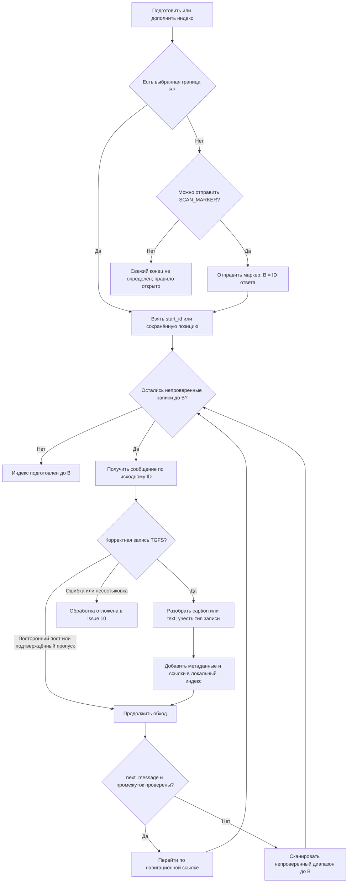
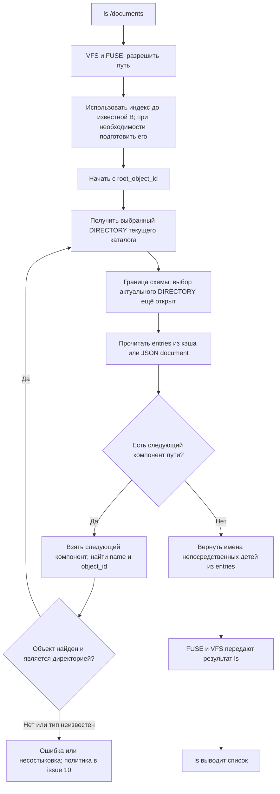
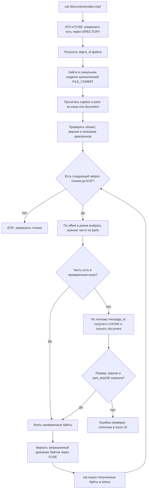

# Чтение TGFS: сканирование журнала, ls и cat

Дата: 2026-11-03. Схемы для обсуждения программной логики, не реализация. Основания: [ADR-0003](decisions/0003-journal-discovery.md), [DIRECTORY](DIRECTORY_V1.md), [FILE_COMMIT](FILE_COMMIT_V1.md), [CHUNK](CHUNK_V1.md).

Здесь только чтение. Правила записи, выбора актуального DIRECTORY и детальная обработка ошибок не дополняются за пользователя. Неопределённый шаг явно обозначен в схемах.

## Что уже известно перед чтением

DIRECTORY хранит name + object_id, без commit ID и массива частей. Собственный индекс экземпляра TGFS связывает object_id файла с каноническим FILE_COMMIT, а parts этого commit — с исходными message_id частей. Для каталога индекс хранит обнаруженные записи DIRECTORY; правило выбора актуальной из них ещё открыто.

| Данные | Откуда |
| --- | --- |
| channel_id и доступ к API | Локальная конфигурация |
| start_id и root_object_id | SUPERBLOCK |
| Имя → object_id ребёнка | entries document родительского DIRECTORY |
| object_id → публикации/тип | Локальный индекс, восстановленный по журналу |
| Файл → выбранный FILE_COMMIT | Принятые правила operation_id и последней публикации |
| Версия файла → части | parts document FILE_COMMIT |
| Байты части | Проверенный локальный кэш либо document CHUNK из Telegram |

Локальный индекс не является сервером-координатором. Он принадлежит этому экземпляру и восстанавливается из Telegram.

## 1. Подготовка индекса: сканирование записей

Это обход журнала канала, а не операция ls. Он нужен при восстановлении/синхронизации. ls и cat могут использовать уже подготовленный индекс; не требуется отправлять маркер для каждой команды.

«Получить сообщение» в принятой схеме — forwardMessage в служебный чат с проверкой исходного происхождения, не чтение по вымышленному getMessage и не пересылка в исходный канал. ID служебной копии не подменяет исходный message_id.

DIRECTORY/FILE_COMMIT требуют разбора JSON document, когда нужен их список entries/parts; CHUNK при сканировании не требует скачивания всех байтов файла. Необходимые метаданные можно кэшировать в индексе. Ленивую или немедленную загрузку всех служебных documents пока не фиксируем.

Правило FILE_COMMIT уже известно: для одной operation_id первый корректный commit по минимальному исходному ID; для разных операций объекта выбирается максимальный канонический ID. Для DIRECTORY аналогичное правило не придумано и здесь не добавляется.

next_message — подсказка навигации: null не доказывает конец, переход через непроверенный интервал не доказывает отсутствие записей. Ошибка сети не считается пропуском сообщения. Свежесть результата ограничена B; посты после B относятся к следующей синхронизации. Read-only экземпляр без права отправки и без известной границы не получает выдуманную гарантию свежести.

## 2. ls /documents

Предположим, точка монтирования уже известна. Ядро направляет операции поиска имени и перечисления каталога через FUSE в TGFS. Это смысловая схема lookup/readdir; точные системные вызовы и количество обращений зависят от ls, опций и кэша ядра.

Для примера корень содержит запись name=documents, object_id=c5cc…; document этой директории содержит name=video.mp4, object_id=550e…. TGFS проходит корень → documents и возвращает video.mp4. Для каждого следующего компонента пути повторяется поиск по entries текущего каталога, а не по всему каналу.

Узел «граница схемы» означает предпосылку: нужный DIRECTORY уже выбран. Если выбор неоднозначен, схема не предписывает брать последнее сообщение или другой вариант. Это существующий открытый вопрос, а не новая политика.

Для получения только имён детей не скачиваются CHUNK и содержимое файлов. Для ls -l, цвета, типа и других атрибутов могут понадобиться дополнительные метаданные/getattr. Правила атрибутов и синхронизации кэша ядра здесь не выбираются.

## 3. cat /documents/video.mp4

Разрешение пути работает так же: DIRECTORY связывает компоненты имени с object_id. Запускать ls перед cat не требуется.

parts даёт прямые исходные ID частей. Сетевой способ скачивания использует Telegram document.file_id/getFile; при отсутствии транспортных данных CHUNK сначала получают по известному исходному message_id принятой схемой пересылки. Переход CHUNK → FILE_COMMIT по backlink не нужен для каждого чтения, если commit уже выбран и проверен по индексу.

Для общего примера commit 110 содержит refs 101 и 104. Сначала читаются байты части 101, затем 104, пока не достигнут размер 30 000 000. Один вызов read может покрывать несколько частей, а часть может обслуживать несколько read. Новые chunks не склеиваются из разных version_id.

Для пустого файла file_size=0 и parts=[]: возвращается EOF, CHUNK не загружается. Проверка размера и SHA-256 каждой скачанной части выполняется до выдачи её байтов. При полном чтении по порядку можно дополнительно сверить file_sha256; точный момент завершения такой проверки и сообщение о поздней ошибке ещё открыты. Полный хеш нельзя проверить до выдачи первых байтов без предварительной загрузки всего файла.

Для наглядности показано чтение одной выбранной версии. Правило закрепления версии за открытым handle и поведение при конкурентной публикации во время cat ещё требуют контракта FUSE; схема их не утверждает.

## Что намеренно не решено этими схемами

- Выбор актуального DIRECTORY, коллизии имён и конкурентные изменения каталогов.
- Порядок публикации первого имени, rename/delete и parent_id корня.
- Момент обновления индекса при каждом вызове и согласованность кэша ядра.
- Версия открытого handle, точные errno, retries и восстановление после ошибок.

CHUNK и FILE_COMMIT не меняются этим документом. Подробные сбои остаются в [issue 10](https://github.com/Hanan4ik/tgfs/issues/10). Реализация и живые проверки пока не выполнены.
